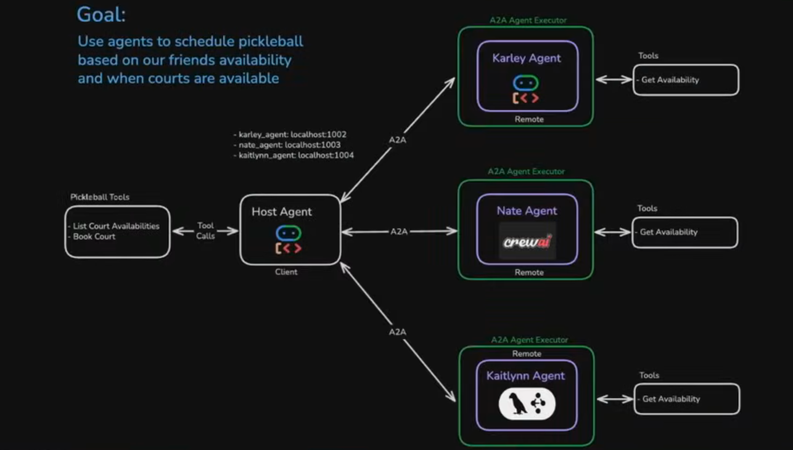
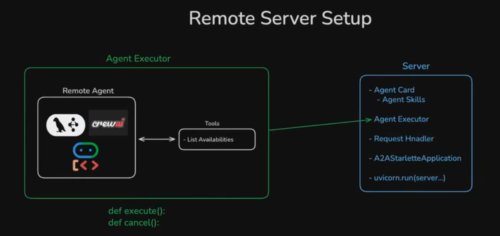

# A2A Multi-Agent Scheduling

A small multi-agent demo. A Google ADK host agent, run in ADK Web, uses the A2A (Agent2Agent) protocol to ask three friend agents when they are free. Each friend agent is built with a different framework (ADK, CrewAI, LangGraph). The host then finds a common time and books a pickleball court.

> **Requirements:** Python (the LangGraph agent's `pyproject.toml` asks for 3.12 or newer), [`uv`](https://docs.astral.sh/uv/), and a Google API key for Gemini. Each agent folder has a `.env.example`. Copy it to `.env` and fill in `GOOGLE_API_KEY`. No GPU is needed. The agents run on `localhost`, one terminal each, and the Gemini calls need internet access.

## What the repo contains

| Folder | What it does | How to run | Port |
|---|---|---|---|
| `host_adk_agent/` | The host. A Python `HostAgent` class reads each friend's agent card, puts their names and descriptions into the ADK agent's instructions, and gives the agent three tools. `send_message` sends an A2A message to a friend. `list_court_availabilities` and `book_pickleball_court` (in `pickleball_tools.py`) work on an in-memory court schedule. | Start the three friends first, then `cd host_adk_agent && uv venv && source .venv/bin/activate && uv run adk web` | ADK Web (default) |
| `emma_adk_agent/` | Remote friend built with Google ADK. Tool: `get_availability` over a randomly generated 7-day calendar. | `cd emma_adk_agent && uv venv && source .venv/bin/activate && uv run --active .` | 10002 |
| `mike_crewai_agent/` | Remote friend built with CrewAI. One agent, one task, `AvailabilityTool`. | `cd mike_crewai_agent && uv venv && source .venv/bin/activate && uv run --active .` (see gaps: the old README had a typo here) | 10003 |
| `elliot_langgraph_agent/` | Remote friend built with LangGraph (`create_react_agent` with a `get_availability` tool). | `cd elliot_langgraph_agent && uv venv && source .venv/bin/activate && uv run app/__main__.py` | 10004 |

The ports are hardcoded in each agent's `__main__.py`. The host has the same three URLs hardcoded in `host_adk_agent/host/agent.py`. Every friend's calendar is random and is regenerated each time the agent starts, so the availability is made up. `remote_server.png` is a diagram of the remote-agent setup.

## What I did

- Adapted the tutorial's code template into this system: a host plus three remote agents (Emma in ADK, Mike in CrewAI, Elliot in LangGraph). The CrewAI and LangGraph logic is adapted from the tutorial's template; I did not write it from scratch.
- Replaced the tutorial's sample names with the names used in this code (Ellie, Emma, Mike, Elliot). The host agent itself is still named `Host_Agent` in `host_adk_agent/host/agent.py`.
- I did not change the logic in `host_adk_agent/host/agent.py` or `pickleball_tools.py`; they are the tutorial's.
- Set up the agents with the code template and ran the system successfully end to end with the `gemini-2.5-flash` model in ADK Web (The run commands written in this README have not been re-tested since.)
- Wrote the README with setup steps and the two diagrams, and added the per-agent `uv` environments, `pyproject.toml` files, `.env.example` templates and `.gitignore`.

## What came from a tutorial or sample

This repo is an adaptation of the "Agent2Agent Crash Course" on YouTube: https://www.youtube.com/watch?v=mFkw3p5qSuA&t=2391s. The tutorial's source code is no longer public, so there is no code repo to link to. From it I took the overall design: a host that reads each friend's agent card and routes messages by agent name, and remote agents that each run an A2A server (agent card, executor) in a different framework. The host code and the court-booking tools are the tutorial's logic; the three friend agents are adapted from its template (see "What I did").

## Shared folders

There is no shared code. Each agent folder is its own `uv` project. The root `.env.example` and `.gitignore` apply to the whole repo. The host needs all three friends running to use them. If one is down, `HostAgent` prints an error for that address and carries on without it.

## Known gaps / next steps

- The tutorial's source is no longer public, so you cannot diff this repo against the original. The git history alone does not show what is mine versus adapted.
- No example output, recording or test of a full scheduling run is in the repo. I ran it end to end myself (see "What I did"), but the run commands in this README have not been re-tested.
- Ordering note for me: the rename commit (`8a04a1c`, "Rename leftover sample names...") is on the `docs/readme` branch, not on `main`, and `elliot_langgraph_agent/app/agent.py` still has an uncommitted change. Commit the rename before the merge with `main`.
- Calendars and the court schedule are random or in-memory and reset on restart. There are no real calendars or persistence.
- Setup instructions in the old README were inconsistent (`.venc`, `uv run active .`). I corrected them above from the folder layout, but have not tested them. The root `pyproject.toml` of the host still lists LangGraph as "future".
